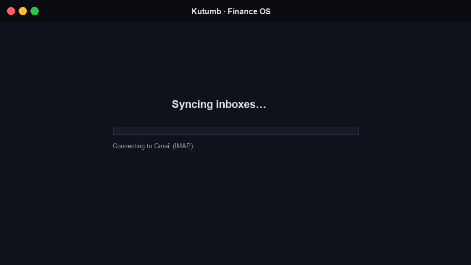
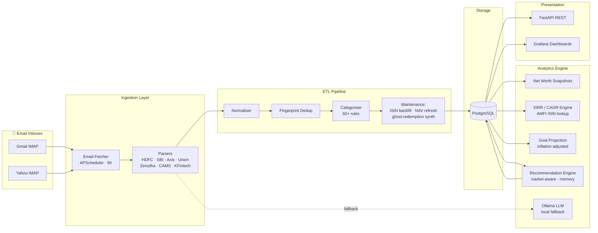
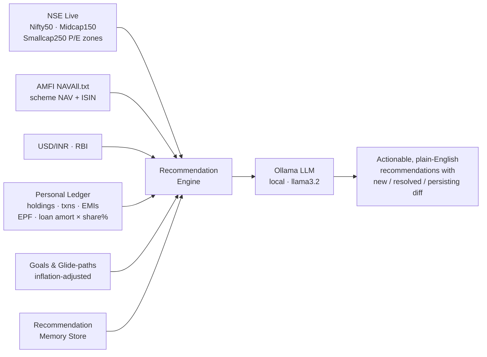

# 💰 Kutumb — Family Financial Dashboard

A self-hosted, private, email-driven personal finance tracker for the whole family.
One `docker-compose up` gives you a live Grafana dashboard fed by your bank & investment statements.

> **Docs:** [Architecture](docs/ARCHITECTURE.md) · [Decisions](docs/DECISIONS.md) · [ADRs](docs/adr/) · [Benchmarks](docs/BENCHMARKS.md) · [Performance](docs/PERFORMANCE.md) · [Experience](docs/EXPERIENCE.md) · [Production Readiness](docs/PRODUCTION_READINESS.md) · [Setup](SETUP.md) · [Submission](docs/SUBMISSION.md)

---

## Demo

<!-- Drop a short screen recording here. GitHub auto-renders .mp4/.mov/.gif up to 100 MB.
     Easiest: open an Issue in this repo, drag the file into the comment box, copy the
     generated `https://user-images.githubusercontent.com/...` URL, and paste below. -->



> _Record with [LICEcap](https://www.cockos.com/licecap/) (GIF) or QuickTime → save to `docs/media/demo.gif` (or `.mp4`). Keep under ~15 MB for fast README loads._

---

## Why Kutumb?

Most personal finance tools either:
- Require sharing financial data with third parties
- Focus only on budgeting
- Lack Indian financial instruments (PPF, NPS, ELSS, SGB, CAMS/KFintech CAS)
- Provide little actionable planning

Kutumb is a **privacy-first financial operating system for Indian households** — everything runs locally, ingests official email statements only, and produces actionable, market-aware recommendations.

---

## Architecture



All components run as Docker services on the user's machine — no cloud, no third-party APIs (except market-data fetches: AMFI NAV file, NSE indices).

---

## ⭐ The Recommendation Engine — Where It All Comes Together

This is the heart of Kutumb. Every other component feeds into it.



**What makes it different:**

| Input | What it contributes |
|---|---|
| **NSE live P/E zones** | Tells the engine *when* to buy / pause / redirect — Midcap150 in EXPENSIVE zone → pause midcap SIPs |
| **AMFI NAV + ISIN** | Joins your Coin transactions to current scheme NAV; flags scheme overlaps and direct-equity scatter |
| **Personal loan amortisation × your share%** | Computes real 80C usage from home-loan principal → catches ELSS dead-weight that generic advisors miss |
| **EPF FY contributions** | Combined with loan principal, gives true 80C headroom — not a guess |
| **Goal glide-paths** | Inflation-adjusted corpus gaps → SIP amounts that actually close the gap |
| **Memory store** | Diff vs last month: new triggers, resolved items, what's been persisting and for how long |
| **Ollama (local LLM)** | Turns the structured reasoning into plain-English explanations — no cloud, no data leaves the machine |

**Sample output (from the demo):**
> _"Midcap 150 P/E 34.8 (EXPENSIVE zone, >1σ above 10yr median). Your portfolio is 42% high-beta (28% midcap + 14% smallcap). **→ Pause ₹ 15k/mo midcap SIP + ₹ 7.5k/mo smallcap SIP, redirect to Nifty 50 index until P/E returns to FAIR zone.**"_

No SaaS robo-advisor knows your home-loan share, your spouse's PPF balance, or that your EPF already maxed 80C. Kutumb does, because it lives next to your data.

---

## Interesting Engineering Problems Solved

### Statement Normalisation across 7 institutions
Every bank and broker ships a different PDF layout, CSV schema, and date format. HDFC alone has two layout variants and headerless continuation pages. Built per-institution parsers with shared normalisation downstream, plus a local-LLM fallback (Ollama) for unseen layouts.

### Fingerprint-based Dedup
Reprocessing a statement must never double-count. Each transaction gets a stable fingerprint (account + date + amount + normalised ref/narration) that survives whitespace, padding, and Decimal precision drift.

### Portfolio XIRR across heterogeneous vehicles
Money-weighted returns computed across mutual funds, direct equity, SGBs, FDs/RDs, and PPF — at family / class / owner / instrument / goal granularity. Coin transactions are joined to holdings via AMFI ISIN lookup (NAVAll.txt cached 24h, scheme renames handled). SGB purchases synthesized at RBI tranche date; FD principals compounded at stated rate.

### Net Worth Reconstruction
Daily historical snapshots reconstructed by replaying statement history through the engine — no need for the user to have used the tool from day one.

### Goal Projection Engine
Inflation-adjusted corpus targets with the SIP required to close each gap, considering current trajectory and existing assets earmarked.

### Market-aware Recommendations + Memory
Recommendations consider live Nifty 50 / Midcap 150 / Smallcap 250 P/E zones (NSE) and the user's real loan amortisation × co-borrower share for ELSS 80C dead-weight detection. Persistent snapshots produce a new / resolved / persisting diff so multi-month progress is visible.

---

## AI Features

- **Local LLM via Ollama** (llama3.2) — runs in Docker, zero cloud calls
- **Statement-understanding fallback** for unseen PDF layouts when deterministic parsers don't match
- **Recommendation explanation** generation in plain language
- Fully local inference — financial data never leaves the machine

---

## Performance

Validated against the author's real household data:

| Metric | Value |
|---|---|
| Historical horizon | 2+ years of transactions |
| Bank transactions | Thousands across 4 banks |
| Investment records | Hundreds of MF / equity / SGB rows |
| Dashboard query latency | Sub-second on Grafana panels |
| Full sync (6h cadence) | < 30s typical |
| Reprocess full history | < 2 min |

See [docs/BENCHMARKS.md](docs/BENCHMARKS.md) for detailed numbers.

---

## What it does

| Feature | Detail |
|---|---|
| **Email ingestion** | Connects to Gmail + Yahoo (IMAP) every 6h, downloads statement attachments |
| **Bank parsers** | HDFC, SBI, Axis Bank, Union Bank of India — CSV & PDF |
| **Investment parsers** | Zerodha Kite (holdings + tradebook + contract notes), Zerodha Coin (allotments/redemptions, old + new email format), CDSL CAS, CAMS/KFintech CAS MF PDFs |
| **Portfolio XIRR / CAGR** | Money-weighted returns across every vehicle — family, per-class, per-owner, **per-instrument**, per-goal. Coin txns are joined to holdings via **AMFI ISIN lookup** (NAVAll.txt, 24h cached, scheme renames handled). SGB purchases synthesized at RBI tranche date; FD/RD principals compounded at stated rate. |
| **Smart categorisation** | 60+ rules for EMI, insurance, salary, groceries, SIPs, child expenses, travel, SGB, PaytmQR merchants… Auto-recategorizes on every sync. |
| **Data hygiene** | Fingerprint-based dedup prevents any statement from being double-counted on reprocess. Normalises ref-number padding/whitespace, DEMAT unit-count rows, and Decimal precision. Post-sync maintenance pipeline runs automatically: dedup → account-merge → ISIN backfill → NAV refresh → ghost-redemption synth → recategorize. |
| **Net worth tracking** | Daily snapshots per person + family combined |
| **Goal projections** | Inflation-adjusted corpus targets with SIP calculator |
| **Recommendations** | Emergency fund · goal shortfalls · asset allocation · EMI burden · PPF nudge. **Portfolio-quality**: midcap/smallcap overweight, international gap, scattered direct equity, **ELSS 80C dead-weight** (uses real loan amortisation × your co-borrower share). **Market-aware**: where + how much + when, given live Nifty 50 / Midcap 150 / Smallcap 250 P/E zones from NSE. **Memory**: persistent snapshots with new/resolved/persisting diff and metric trend arrows so multi-month progress is visible. |
| **Grafana dashboards** | 4 pre-built dashboards auto-wired to Postgres |
| **Manual entry API** | Add PPF, NPS, gold, real estate via REST API |
| **100% private** | Everything runs locally in Docker; private GitHub repo for code |

---

## Quick Start

### 1. Clone & configure

```bash
git clone https://github.com/YOUR_USERNAME/kutumb.git
cd kutumb

# Copy and fill in secrets
cp .env.example .env
nano .env

# Copy and fill in account config
cp config/accounts.example.yml config/accounts.yml
nano config/accounts.yml
```

### 2. Get email App Passwords (NOT your login password)

**Gmail:** myaccount.google.com → Security → 2-Step Verification → App passwords  
**Yahoo:** security.yahoo.com → Generate app password → Select "Mail"

### 3. Start everything

```bash
docker-compose up --build
```

- **App API:** http://localhost:8000
- **API docs:** http://localhost:8000/docs  
- **Grafana:** http://localhost:3000 (admin / `GRAFANA_PASSWORD` from .env)

### 4. Import historical data

On first run, trigger a 2-year historical import:

```bash
curl -X POST "http://localhost:8000/api/sync/historical?since_days=730"
```

Or trigger a regular sync:
```bash
curl -X POST "http://localhost:8000/api/sync/now"
```

---

## Setting Up Statement Emails

For each bank / broker, set up email statements to be sent to your registered email:

| Institution | Where to set up |
|---|---|
| **HDFC Bank** | NetBanking → My Account → e-Statement (monthly) |
| **SBI** | OnlineSBI → e-Statement → Register for e-statement |
| **Axis Bank** | NetBanking → My Profile → e-Statement |
| **Union Bank** | NetBanking → My Account → e-Statement |
| **Zerodha Kite** | Console → Profile → Enable Holdings + Tradebook email |
| **CAMS (Coin MF)** | camsonline.com → mailback → CAS PDF |
| **KFintech** | kfintech.com → CAS statement by email |

---

## Adding PPF / FD / NPS (Manual Assets)

PPF doesn't send email statements. Add them via the API:

```bash
# Add your PPF (SBI)
curl -X POST http://localhost:8000/api/manual/assets \
  -H "Content-Type: application/json" \
  -d '{
    "owner_id": "user",
    "asset_type": "ppf",
    "institution": "SBI",
    "name": "PPF Account",
    "current_value": 450000,
    "interest_rate": 7.1,
    "start_date": "2018-04-01"
  }'

# Add wife's PPF (Union Bank)
curl -X POST http://localhost:8000/api/manual/assets \
  -H "Content-Type: application/json" \
  -d '{
    "owner_id": "wife",
    "asset_type": "ppf",
    "institution": "Union Bank",
    "name": "PPF Account",
    "current_value": 320000,
    "interest_rate": 7.1
  }'
```

Update the value quarterly when you check your passbook.

---

## Grafana Dashboards

| Dashboard | What you see |
|---|---|
| **💰 Net Worth** | Family total, per-person, trend over time, asset allocation donut |
| **💸 Cash Flow** | Monthly income vs expenses, EMI tracker, category breakdown, top spends |
| **📈 Investments** | Full holdings table, P&L, portfolio allocation, value trend |
| **🎯 Goals & Planning** | Goal progress bars, SIP required, corpus gaps, family milestones |

Default login: `admin` / password from `.env` (`GRAFANA_PASSWORD`)

---

## API Reference

| Endpoint | Method | Description |
|---|---|---|
| `/api/sync/now` | POST | Sync emails + compute net worth |
| `/api/sync/historical?since_days=730` | POST | Import 2 years of history |
| `/api/accounts/networth?owner_id=family` | GET | Net worth history |
| `/api/accounts/holdings` | GET | All current holdings |
| `/api/transactions?owner_id=user&category=emi` | GET | Filter transactions |
| `/api/transactions/summary` | GET | Monthly income/expense summary |
| `/api/goals/` | GET/POST | List / create goals |
| `/api/goals/projections` | GET | Corpus projections with SIP needed |
| `/api/goals/recommendations` | GET | Actionable recommendations (market-aware; snapshots silently for memory) |
| `/api/goals/recommendations/changes` | GET | Diff vs prior snapshot: new / resolved / persisting + metric trends |
| `/api/goals/market-signals` | GET | Current Nifty 50 / Midcap 150 / Smallcap 250 P/Es + zones + USD/INR (12-hr cached) |
| `/api/portfolio/returns?owner_id=family` | GET | Total + per-class + per-instrument + per-goal XIRR / CAGR; Coin txns ISIN-matched via AMFI |
| `/api/profile/{owner_id}` | PUT | Edit owner's tax regime, EPF, home-loan share% (drives 80C check) |
| `/api/manual/assets` | GET/POST | PPF, FD, NPS, liabilities (EMI + interest_rate on loan rows) |

To backfill ISINs on historical Coin transactions after upgrading:

```bash
docker exec finance_app python -m scripts.backfill_coin_isins
```

Full interactive docs: http://localhost:8000/docs

---

## Privacy & Security

- **No cloud databases.** PostgreSQL runs inside Docker on your machine.
- **No third-party services.** Everything is self-hosted.
- **Private GitHub repo** keeps code private. `config/accounts.yml` and `.env` are git-ignored.
- **App passwords** (not your actual email password) are used for IMAP — can be revoked anytime.
- **No bank scraping** — uses only official email statements (safe, no risk of account lock).

---

## Running on a New System

```bash
# Pull the private repo
git clone https://github.com/YOUR_USERNAME/kutumb.git
cd kutumb

# Recreate .env and config/accounts.yml (not in git)
cp .env.example .env && nano .env
cp config/accounts.example.yml config/accounts.yml && nano config/accounts.yml

# Start
docker-compose up --build -d
```

Data is persisted in Docker named volumes (`postgres_data`, `grafana_data`).
To move data between machines, export/import the postgres volume.

---

## Project Structure

```
kutumb/
├── app/
│   ├── ingestion/         # Email fetcher + statement parsers
│   │   └── parsers/       # HDFC, SBI, Axis, Union Bank, Zerodha, CAS MF
│   ├── etl/               # Normaliser, categoriser, dedup
│   ├── engine/            # Net worth, goals, recommendations
│   ├── api/routes/        # FastAPI endpoints
│   ├── models/            # SQLAlchemy ORM schemas
│   ├── scheduler.py       # APScheduler background jobs
│   └── main.py            # FastAPI app + startup
├── grafana/
│   ├── provisioning/      # Auto-wired datasource + dashboards
│   └── dashboards/        # 4 pre-built JSON dashboards
├── config/
│   └── accounts.example.yml
├── docker-compose.yml
└── .env.example
```
